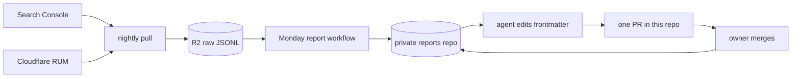

# Weekly SEO report — agent brief

One file to hand an agent. It explains the system, then contains the two prompts:
one to prepare the week's PR, one to record the merge afterwards.

Nothing here is published: root-level Markdown is ignored by Eleventy
(`/*.md` in `.eleventyignore`).

---

## 1. What this is

The site's analytics pipeline pulls Search Console and Cloudflare Web Analytics
nightly into Cloudflare R2. Every Monday a second workflow reads those raw rows
and writes a **weekly report** — a one-screen digest plus a machine-readable
action queue — into a **private** repository.

An agent then works that queue: it edits article frontmatter only, opens one PR,
and the next report measures whether the change worked. No dashboard, no server,
no analytics tag on the site.



## 2. Where things live

| Thing | Location |
|---|---|
| Collection | `lib/analytics/`, `scripts/analytics-pull.js`, `.github/workflows/analytics.yml` |
| Report generator | `lib/analytics/report.js`, `scripts/analytics-report.js` |
| Report schedule | `.github/workflows/analytics-report.yml` — Mondays 06:10 UTC |
| Report output | private repo `09ashishkapoor/jaikhyapaparampara-analytics`, `reports/` |
| Decision record, thresholds | [ANALYTICS-DASHBOARD.md](ANALYTICS-DASHBOARD.md) |
| Article sources | `articles/<slug>.md` |
| Social cards | `images/og/<slug>.jpg`, regenerated by `npm run og` |

The private repo needs the owner's `gh` login; the agent's existing credential
helper already works for clone and push.

## 3. Reading a report

`reports/YYYY-MM-DD.md` is the human digest. `reports/YYYY-MM-DD.actions.json`
is the work order, and it is the **source of truth**: never recompute a metric,
never substitute your own estimate.

Each action looks like this:

```json
{
  "id": "serp-<slug>-<hash>",
  "type": "serp | links | indexing",
  "url": "/articles/<slug>/",
  "source_file": "articles/<slug>.md",
  "query": "the query this page should win",
  "metrics": { "impressions": 0, "clicks": 0, "ctr": 0, "position": 0 },
  "current": { "title": "", "description": "", "keywords": "", "tags": [] },
  "why": "the number that justifies the action",
  "probe": { "kind": "query | page", "key": "" },
  "baseline": {},
  "opened": "YYYY-MM-DD",
  "status": "open"
}
```

The file also carries a `policy` block listing the allowed and forbidden edits
and the required commands. Read it before editing; it is the contract.

Quick look at the newest report:

```bash
gh api repos/09ashishkapoor/jaikhyapaparampara-analytics/contents/reports \
  --jq '.[].name' | sort | tail -4
```

---

## 4. Prompt 1 — prepare the week's PR

Copy everything inside the fence into the agent.

```text
You are preparing this week's SEO improvement PR for jaikhyapaparampara.com.

Source of truth: the newest reports/*.actions.json in the private repository
09ashishkapoor/jaikhyapaparampara-analytics. Clone it shallowly:

  gh repo clone 09ashishkapoor/jaikhyapaparampara-analytics /tmp/reports -- --depth 1

Read the newest .actions.json and its "policy" block. Do not recompute any metric;
the file is the source of truth.

Take at most five actions with status "open", highest priority first (the array is
already ordered). For each action:

- If "source_file" is null, skip it and say why.
- Edit only frontmatter in that file: title, description, metaDescription,
  keywords, tags. Never the body, mantras, quotations, speaker labels,
  translations, images, category, date, or the file name.
- serp: rewrite the title and/or description so the page matches the query's
  intent. Keep the article's actual subject and its lineage names. No clickbait,
  no keyword stuffing.
- links: add 1-3 tags that connect the article to its topic hub and to the
  articles it belongs beside. Reuse existing tags where possible; keep every
  existing tag.
- indexing: no frontmatter edit is required. Put the URL in the PR so the owner
  can request indexing; add a tag only if it improves linking.

If a title changed, run `npm run og` and commit the changed images/og/*.jpg.
Run `npm run build:test` and fix only failures you introduced.

Open exactly one PR in this repository:
  title: SEO: week of <YYYY-MM-DD>
  body: a table of action id | file | query | before -> after, then the action ids
Do not merge it.

Stop and report: the PR URL, the action ids, and anything skipped with the reason.
```

## 5. Prompt 2 — record the merge

Run this only after the owner has merged the PR. The next report measures an
action only when it carries `merged`; without this step the action is marked
`stale` after 21 days.

```text
The SEO PR <PR URL or number> has been merged. Record it in the private reports
repository.

  gh repo clone 09ashishkapoor/jaikhyapaparampara-analytics /tmp/reports -- --depth 1

In the reports/*.actions.json that contains each action id from that PR, set:

  "merged": "<merge date, YYYY-MM-DD>",
  "pr": "<PR URL>"

Leave status, baseline, metrics, probe and the rest of the action unchanged.
Commit with the message "report: mark <date> actions merged" and push.
Report the file and the ids updated. If the PR is not merged yet, do nothing and
say so.
```

---

## 6. Hard rules

- **Sacred text is immutable.** Never edit an article body, mantra, quotation,
  speaker label, or translation. Frontmatter only, and only the five fields above
  (AGENTS rules 1 and 7).
- **Do not change `category`, `date`, or the file name.** The category drives hub
  membership and the taxonomy guard; the date drives feeds and sorting; the file
  name is the URL.
- **One PR, at most five articles.** Bounded review is the point.
- **Never commit report data, traffic JSON, or `.analytics/` to this repo.** The
  report lives only in the private repository. Public CI logs must stay clean.
- **Do not touch `images/gallery/`** and do not add analytics tags, `/stats/`
  links, or third-party trackers.
- **Skip rather than guess.** If `source_file` is null, the article does not match
  the action, or the `why` no longer holds after reading it, leave it untouched
  and say why.
- **A tag is a public page.** Adding a tag creates or extends a `/tags/<tag>/`
  page; reuse existing tags where possible.

## 7. Verify before opening the PR

```bash
npm run og -- --check      # every card current; run `npm run og` if not
npm run build:test         # ~105 s, ~3,700 files
git status --short         # only the intended article files and images/og
```

`npm run test:analytics` covers the report generator, not content edits; run it
only if you touched `lib/analytics/`.

## 8. Troubleshooting

| Symptom | Likely cause | What to do |
|---|---|---|
| No report for this week | Workflow failed, or `REPORTS_REPO` unset | `gh run list --workflow=analytics-report.yml`; read the failed step |
| "Days without a raw object" | A nightly pull gap | Check `analytics.yml` runs; the next pull backfills 7 days |
| An action is `stale` | PR opened but never marked merged | Run prompt 2 for that PR |
| Cloudflare numbers look tiny | Human traffic is genuinely sparse | Treat as directional; Search Console is the primary signal |
| Build fails on taxonomy | `category` was changed | Revert it; only the five frontmatter fields are allowed |

## 9. Why it works this way

- The questions are the same every week, so they are computed, not explored.
  A report arrives; a dashboard waits to be opened.
- Analysis and action are separate. The script owns numbers; the agent owns
  wording. That is why the action queue carries `current`, `why`, and `baseline`.
- Follow-up is the loop. Every merged action is re-measured after 14 days, so the
  next report says whether last week's advice worked. See
  [ANALYTICS-DASHBOARD.md](ANALYTICS-DASHBOARD.md) for the full decision record.
