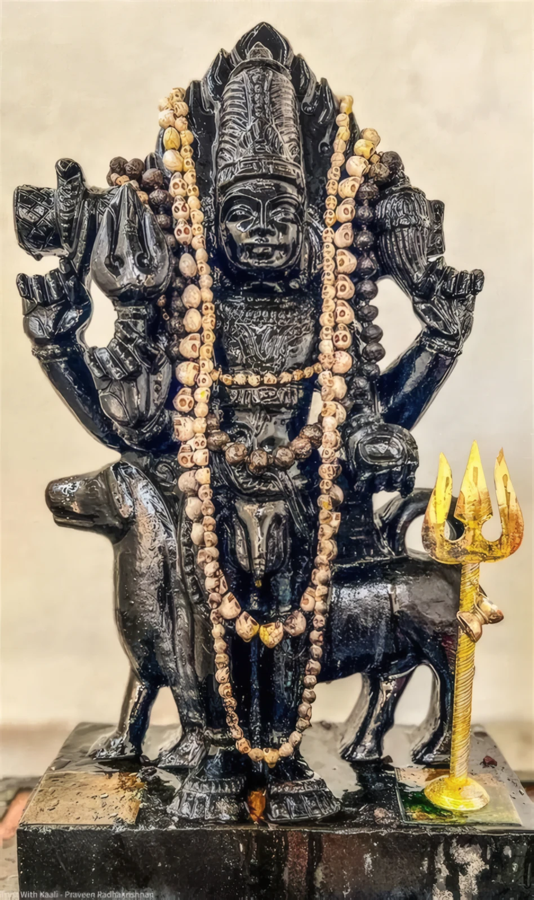

Om Shri Gurubhyo Namah, Jai Ma Adya, Jai Khyapa Parampara.

## 3. KalaDandaDhrite

**Wielder of the rod of time, upholder of divine judgment.**

The third name, **KalaDandaDhrite**, presents Bhairava as the one who bears authority. Here he is not only the Lord of time, but the one who carries its staff, its discipline, and its power to bring every action to its due result.

### Elaboration

This compound joins *Kala* (time or death), *Danda* (staff, rod, scepter), and *Dhrite* (the bearer or holder). The image is direct: Bhairava holds the rod by which time, karma, and order are enforced.

**The Rod of Time**

In dharmic imagery, the rod is a sign of rule and correction. It is not decoration. It means authority. The *Kala Danda* is therefore the staff of time itself - the power by which all beings are brought to consequence, limit, and completion. Nothing escapes that movement.

**Judge Without Partiality**

This name also presents Bhairava as the guardian of justice. His judgment is not sentimental or impulsive. It reflects the exact balance of karma. What has been set in motion ripens at the proper moment, and Bhairava stands as the divine witness who allows no disorder to remain unresolved forever.

**Discipline as Grace**

For the devotee, the rod does not only symbolize punishment. It also represents correction. Bhairava disciplines in order to restore alignment with dharma. The hardships that humble the ego, break false habits, or force truth into view can also be understood as part of his stern compassion.

---

  

    <em>&larr; Previous Name</em> 
    <a href="/articles/kalabhairava-name-002-kala-kalaya/"><strong>2. KalaKalaya</strong></a>
  

  

    <em>Next Name &rarr;</em> 
    <a href="/articles/kalabhairava-name-004-kalatmane/"><strong>4. Kalatmane</strong></a>
  

<h3 style="color:var(--accent-bright);margin-top:0;">Spiritual Insight</h3>

Contemplating <strong>KalaDandaDhrite</strong> encourages sobriety, accountability, and reverence for karma. It reminds the seeker that divine protection is inseparable from divine order.

