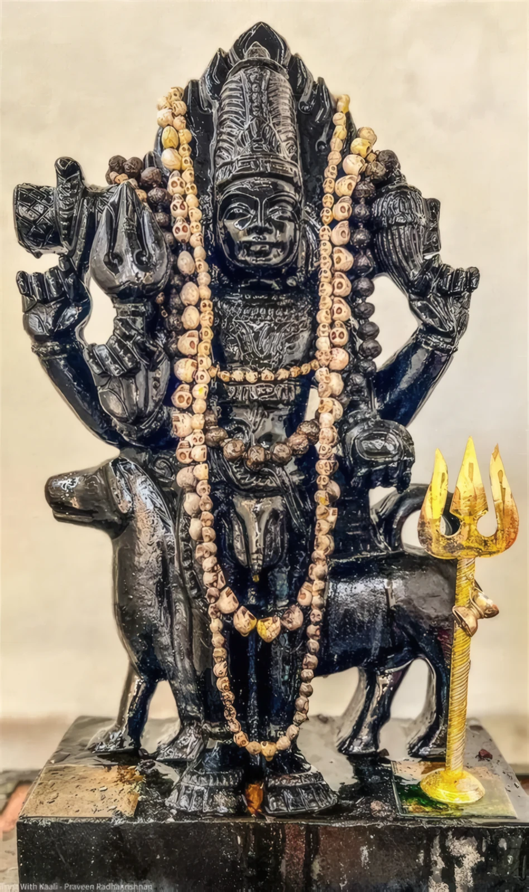

Om Shri Gurubhyo Namah, Jai Ma Adya, Jai Khyapa Parampara.

## 14. KalaKanthaya

**The Dark-Throated One, Bearing the Poison of the Cosmic Ocean.**

The fourteenth name, **KalaKanthaya**, recalls one of the most beloved images in Shaiva tradition: the Lord who holds poison in his throat to protect creation. Applied to Kalabhairava, the name reveals that fierce appearance and deep compassion are not opposites. The same power that terrifies evil also absorbs suffering for the sake of the world.

### Elaboration

KalaKanthaya refers to the Lord as dark-throated or blue-throated. The name clearly points back to the episode of the cosmic poison and links Bhairava to Shiva's act of preserving the worlds through self-sacrifice.

**The Poison of the Churning**

During the churning of the cosmic ocean, the deadly halahala poison arose before the nectar. Its force was so destructive that creation itself was endangered. Shiva consumed it so that the worlds would not perish.

**Why the Throat Turned Dark**

The poison did not pass fully through him. Held at the throat, it marked him as Nilakantha, the blue-throated one. In this Bhairava name, that same image remains alive: the Lord bears destructive force without allowing it to spread.

**Compassion in a Fierce Form**

This is why the name matters. Bhairava is often approached as terrible, but **KalaKanthaya** shows that his terror is never separate from compassion. He does what is necessary to protect the order of things, even when the burden must be taken into himself.

**The Power to Contain Inner Poison**

Spiritually, the poison can also be read as anger, greed, pride, jealousy, and despair. Kalabhairava as **KalaKanthaya** does not merely destroy these impulses from outside. He teaches the seeker how destructive force may be contained, purified, and transformed before it overruns the mind.

---

  

    <em>&larr; Previous Name</em> 
    <a href="/articles/kalabhairava-name-013-kalanemi-ghne/"><strong>13. KalanemiGhne</strong></a>
  

  

    <em>Next Name &rarr;</em> 
    <a href="/articles/kalabhairava-name-015-kataksa-anugrahita-akhila-sevakaya/"><strong>15. KataksaAnugrahitaAkhilaSevakaya</strong></a>
  

<h3 style="color:var(--accent-bright);margin-top:0;">Spiritual Insight</h3>

Contemplating <strong>KalaKanthaya</strong> reminds the seeker that divine strength includes the capacity to bear, contain, and transform poison. Bhairava protects not only by striking, but also by absorbing what would otherwise destroy.

