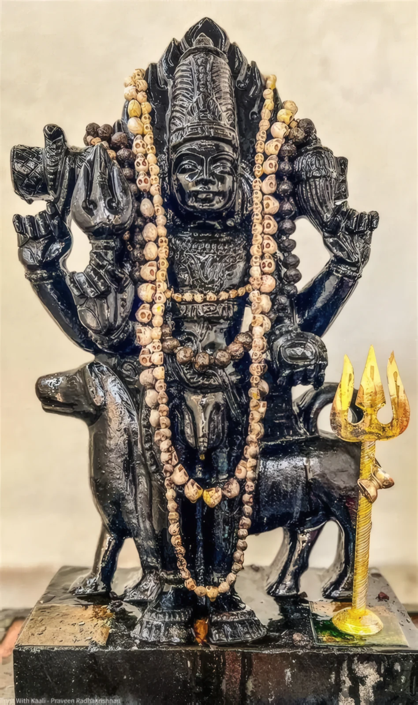

Om Shri Gurubhyo Namah, Jai Ma Adya, Jai Khyapa Parampara.

## 38. KamaRupaVate

**Possessing the Power to Assume any Form at Will.**

The thirty-eighth name, **KamaRupaVate**, presents Bhairava as unrestricted by any single outer form. He can assume whatever form is required by divine will. The name therefore points both to omnipotence and to compassion: the Lord appears in ways that meet the need of the moment.

### Elaboration

This name emphasizes Bhairava's freedom of manifestation.

**Form Directed by Will**

The name joins **kama**, understood here as will or intention, with **rupa**, form. Bhairava is thus one who can take on form according to purpose. He is not confined to a single appearance, mood, or function.

**Manifestation Without Limitation**

Because he is not bound to one fixed embodiment, Bhairava can be fierce, protective, concealed, revelatory, or inwardly present according to what is needed. The name points to the formless divine's ability to enter form without becoming trapped by it.

**Accessible to the Devotee**

This power also carries devotional warmth. The Lord can be encountered in many modes because he is not restricted by our categories. A devotee may meet Bhairava through image, mantra, vision, fear, protection, or insight, and none of these exhaust him.

**A Spiritual Reading**

For the seeker, **KamaRupaVate** teaches that divine reality exceeds every one of its manifestations. Bhairava can assume form, but he is never reduced to the form he assumes.

---

  

    <em>&larr; Previous Name</em> 
    <a href="/articles/kalabhairava-name-037-kama-araye/"><strong>37. KamaAraye</strong></a>
  

  

    <em>Next Name &rarr;</em> 
    <a href="/articles/kalabhairava-name-039-kanthadi-sarva-cakrasthaya/"><strong>39. KanthadiSarvaCakrasthaya</strong></a>
  

<h3 style="color:var(--accent-bright);margin-top:0;">Spiritual Insight</h3>

Contemplating <strong>KamaRupaVate</strong> reminds the seeker that Bhairava is not limited by any single image. The divine can appear in whatever form truth, protection, or awakening requires.

