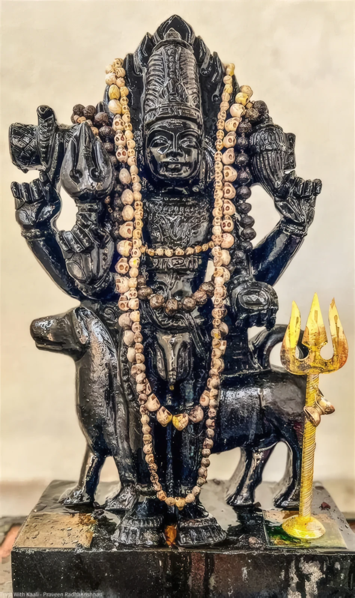

Om Shri Gurubhyo Namah, Jai Ma Adya, Jai Khyapa Parampara.

## 104. GosthasthaBhairavaAgranye

**Foremost among the Bhairavas, the leader of Shiva's hosts.**

The 104th name, **GosthasthaBhairavaAgranye**, presents Lord Kalabhairava as the chief presence within a sacred assembly of fierce powers. It does not praise him as only one guardian among many. It places him at the front: the one who stands foremost among the Bhairavas and leads the gathered hosts that serve Shiva.

### Elaboration

This compound name is understood here through **goshta** (assembly, host, or gathered multitude), **stha** (standing within or abiding among), **Bhairava**, and **agranya** (foremost, chief, or leader).

**Foremost in the divine host**

The name first emphasizes rank. Kalabhairava is not described as an isolated fierce form, but as the one who stands pre-eminent within a larger host of Bhairavas and attendant powers. In that sense, **Agranye** points to seniority, command, and unquestioned spiritual authority.

**Leader among the ganas**

The image of the host naturally calls to mind Shiva's **ganas**, the divine retinue that carries out his will. When this name places Kalabhairava among that gathered force, it does so to show him as their chieftain rather than a companion of equal standing. He is the ordering power within the assembly, the one under whom the host moves.

**Authority joined with protection**

Because he leads such a formidable retinue, this name also carries a protective meaning. The devotee is invited to see Kalabhairava not only as fierce, but as the guardian who commands divine forces capable of removing obstacles, subduing hostile influences, and keeping order where confusion would otherwise prevail.

**What this name teaches**

To contemplate **GosthasthaBhairavaAgranye** is to remember Bhairava as the foremost guardian in the divine assembly. The name inspires reverence, but also steadiness: if he is the leader of the host, then the seeker can approach him as the one whose authority is already greater than the forces that create fear or disorder.

---

  

    <em>&larr; Previous Name</em> 
    <a href="/articles/kalabhairava-name-103-karma-bandha-akhila-chedine/"><strong>103. KarmaBandhaAkhilaChedine</strong></a>
  

  

    <em>Next Name &rarr;</em> 
    <a href="/articles/kalabhairava-name-105-katora-aujasya-bhisma-ajna-paala-kinkaara-sevitaya/"><strong>105. KatoraAujasyaBhismaAjnaPaalaKinkaaraSevitaya</strong></a>
  

<h3 style="color:var(--accent-bright);margin-top:0;">Spiritual Insight</h3>

Contemplating <strong>GosthasthaBhairavaAgranye</strong> helps the seeker remember Bhairava as the chief of Shiva's hosts, whose authority protects the path and steadies the heart.

